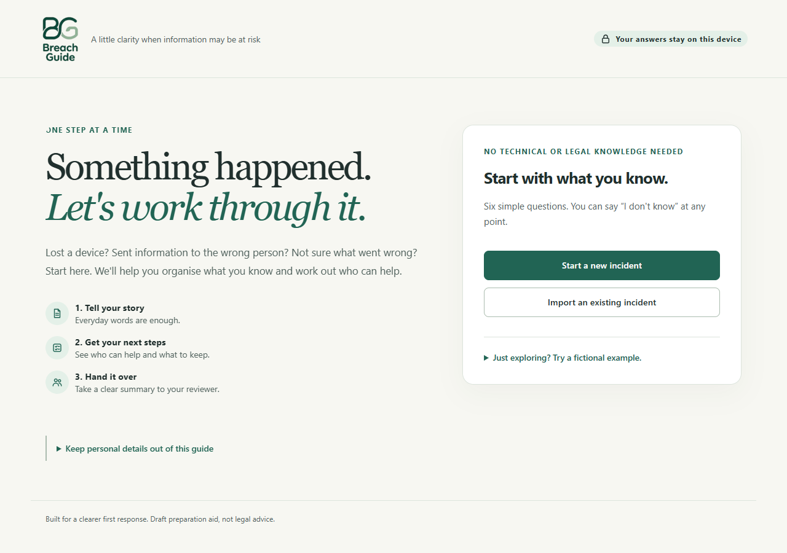
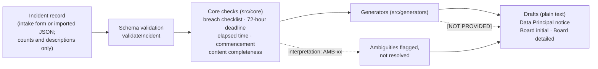

# Breach Guide · dpdp-breach-kit


A free, open-source guide for people who need a place to start after a possible privacy
incident. Answer six plain-language questions, identify what is still unknown, and download
a summary for your manager or privacy reviewer. No account or paid service is needed.

## Start here

- **Browser demo (pending first deployment):** [Breach Guide on GitHub Pages](https://pvud14.github.io/dpdp-breach-kit/).
  This link becomes available after the release PR is reviewed and merged, Pages is enabled,
  and the CI deployment succeeds. If it returns 404, use the local instructions below.
- **Visual walkthrough:** [Download the PDF SOP](public/guide/Breach-Guide-SOP.pdf).
- **Prefer text?** [Beginner instructions](docs/GETTING-STARTED.md).
- **Want to practise?** Open “Just exploring? Try a fictional example.” in the application.

Use fictional information in the public demo. This is a community draft aid, not a government
service, official filing portal or compliance guarantee. No report is submitted automatically.



> **Status: draft.** This is a draft aid, not legal advice, and it has not been independently verified.
> The human verification checklist in [docs/VERIFICATION.md](docs/VERIFICATION.md) is not yet complete.
> Do not rely on it for a real incident without your own legal review.

Tools for preparing personal data breach intimations under **Rule 7 of the Digital Personal Data
Protection Rules, 2025** (DPDP Rules), read with s.8(6) of the Digital Personal Data Protection Act,
2023. Requirements, official sources and every known ambiguity are in
[docs/requirements.md](docs/requirements.md).

> **Draft aid — not legal advice.** This project helps you organise facts and produce *drafts*. Its
> breach checklist reports how the facts you recorded compare with the Act's definition (for
> example "required on the facts recorded" or "indeterminate"); that is not a legal decision on
> whether to intimate. It does not resolve ambiguities in the law and does not replace review by a
> qualified lawyer. Where the text is ambiguous, the code says so (`AMB-xx` references) instead of
> choosing silently.

## Status as of 2026-10-22

**Commencement of Rule 7.** The Rules do not print a calendar date. Rule 1(4), as corrected by
G.S.R. 892(E), brings Rule 7 into force "eighteen months after the date of publication in the
Official Gazette"; the Rules were published on 13 November 2025 (G.S.R. 846(E)). Act s.8(6)
commences "eighteen months from the date of publication" under G.S.R. 843(E).

- **Computed date: 13 May 2027** (publication date + 18 calendar months, in force from 00:00 IST).
  This is a computation, not a stated date. An alternative reading gives 14 May 2027 (AMB-14).
- **As of 2026-10-22, Rule 7 is not yet in force** on that computation.
- No amendment to the Rules after the 10 December 2025 corrigendum was found as of 2026-10-22;
  that search was not exhaustive (see docs/requirements.md §7).

**Board format.** **No official Data Protection Board breach-report format, template or portal was
found as of 2026-10-22** (see docs/requirements.md §6). The Board drafts produced here are plain
text organised by the content Rule 7(2) requires; they are not an official form, and no submission
channel is assumed (AMB-08).

Check these points again before relying on them: both can change after the date above.

## How it fits together



Every function that meets an ambiguity returns an `interpretation` entry naming its `AMB-xx` ID;
the drafts end with the list of ambiguities that apply and a plain-language review checklist.

## What is here

| Path | What it is |
|---|---|
| `src/core` | Incident schema and types, breach checklist (Act s.2(u), s.17(1)), 72-hour deadline, "without delay" elapsed-time tracker, commencement banner, content completeness. No DOM, network or storage access. |
| `src/generators` | Plain-text drafts: the Data Principal notice (r. 7(1)) and the Board initial (r. 7(2)(a)) and detailed (r. 7(2)(b)) intimations. Missing facts appear as `[NOT PROVIDED]`; nothing is invented. |
| `src/ui`, `index.html` | Static intake page: form, live checks, drafts, JSON import/export. |
| `docs/requirements.md` | Requirements and every known ambiguity (`AMB-xx`), taken from the official texts. |
| `docs/source/` | [SOURCES.md](docs/source/SOURCES.md): URL, file name, SHA-256, page count, identifier and download date for each official PDF. The PDFs themselves are not committed; download them here and run `npm run verify:sources`. |
| `docs/tabletop/` | Facilitator guide and six fictional tabletop scenarios, each with an example incident record. |
| `docs/VERIFICATION.md` | Checks a person must do before relying on or publishing this work. |
| `docs/RELEASE-READINESS.md` | Every claim in this README and the launch drafts, with its evidence. |
| `docs/launch/` | Draft launch post and demo-recording steps. |
| `scripts/` | Network check, source-hash check, and the Vitest launcher. |

## Using the intake page

Install a compatible Node.js version (the project requires 22.12 or later) and Git, then open
a terminal in a folder where you want to keep the project. The commands do not require a
particular drive or folder name:

```sh
git clone https://github.com/PVUD14/dpdp-breach-kit.git
cd dpdp-breach-kit
npm ci
npm run build      # library into dist/, intake page into dist/app/
npm run preview -- --host 127.0.0.1 --port 4173 --strictPort
```

Open **http://127.0.0.1:4173/** on the same computer. Keep the terminal open; stop it with
Ctrl+C after saving. On Windows PowerShell, use `npm.cmd` instead of `npm` if script execution
is blocked. Without Git, use **Code → Download ZIP**, extract it, and open a terminal inside
the extracted project folder before `npm ci`.

**Serving requirement.** The page must be served over HTTP or HTTPS. Opening `dist/app/index.html`
directly from disk (`file://`) does not work, because browsers block ES modules there. Any static
file server can host `dist/app/`. Copy-to-clipboard additionally needs a secure context (HTTPS or
`localhost`); otherwise the page asks you to copy manually. The Content-Security-Policy is set by a
`<meta>` tag; if you host the page, also send it as an HTTP header, which is the only way to add
`frame-ancestors`.

**Privacy.** After loading its local/static assets, the app makes no API requests and does not
transmit answers (CSP `connect-src 'none'`). It uses no browser
storage, cookies or service workers, and keeps the record in memory only: **export the incident
JSON to keep it.** Imported files are checked against the schema and rejected if they contain
unknown fields. Do not enter names, contact details or other personal data: the record holds
counts and descriptions only. A public host receives ordinary page-request metadata; the
app's privacy checks do not audit GitHub's hosting logs. Downloaded files are not automatically
encrypted. See [hosting decision and limitations](docs/PUBLIC-RELEASE.md).

**Accessibility.** The local Chrome checks cover labels, draft-tab arrow keys, keyboard
reachability of visible controls, 360px overflow, and non-announcing timer panels. Lighthouse
12.8.2 scored 100/100 on the start, interview, beginner summary, reviewer, practice, and mobile dark-mode states
on 24 October 2026. These are automated checks, not a claim of full accessibility conformance.
Desktop and mobile screen-reader walkthroughs remain unverified; see
[docs/RESPONSE-WORKSPACE.md](docs/RESPONSE-WORKSPACE.md).

## Tabletop exercises

[docs/tabletop/](docs/tabletop/facilitator-guide.md) has a facilitator guide and six fictional
scenarios (ransomware at a data processor, misconfigured storage bucket, insider exfiltration,
lost unencrypted laptop, phishing leading to account takeover, third-party API leak). Each runs in
60–90 minutes, has timed injects from T+0 to T+72h, and ships an example incident record you can
import into the intake page. Ambiguities are posed as questions; no scenario states a legal
conclusion.

## Timestamps

- Every timestamp in an incident record is ISO-8601 **with an explicit offset**, e.g.
  `2026-10-20T09:00:00+05:30` or `2026-10-20T03:30:00Z`. Times without an offset are rejected.
- The intake page **enters and displays times in IST (Asia/Kolkata, UTC+05:30)**. IST has no
  daylight saving, so 72 hours is always exactly 72 elapsed hours.
- A record imported with another offset is shown in IST and, when exported again, written with
  `+05:30`. The instant is unchanged; only its representation changes.
- The form records times to the second; fractions of a second in an imported record are dropped
  if it is edited and exported from the page.
- The 72-hour deadline needs an explicit choice of whose awareness starts the clock (Data
  Fiduciary, Data Processor, or earliest). There is no default (AMB-01, AMB-13). Whether a report
  at exactly 72:00:00 is in time is reported as "at deadline", not decided (AMB-18).

## Scripts

Requires Node.js 22.12 or later.

| Script | What it does |
|---|---|
| `npm run check` | `tsc -p tsconfig.lint.json`: the TypeScript compiler with extra strictness checks (unused locals and parameters, implicit returns, switch fallthrough, unreachable code, index-signature property access). It is **not** ESLint: no style rules, because the project takes no dependencies beyond TypeScript, Vite and Vitest. `npm run lint` is an alias. |
| `npm run typecheck` | `tsc -p tsconfig.json` (strict, no emit). |
| `npm test` | Runs the Vitest suite once, through `scripts/run-vitest.mjs`, which normalises a lower-case Windows drive letter (see CONTRIBUTING.md). |
| `npm run build` | Builds the library (`src/index.ts`) into `dist/`, then the intake page into `dist/app/`. |
| `npm run dev` | Vite dev server for the page. Hot reload does not work: the CSP blocks its WebSocket. |
| `npm run preview` | Serves the built `dist/app/` locally. |
| `npm run check:network` | Builds `dist/app/`, serves it on `127.0.0.1`, and drives a local headless Chrome/Chromium through the page (fill, tabs, copy, download, export, import, 360px width). Fails on any request outside the page's own origin, any CSP violation or page exception, or any storage or cookie use. Needs Chrome or Chromium installed; no npm dependency. Set `CHROME_PATH` to choose the binary and `CHROME_NO_SANDBOX=1` where the Chrome sandbox is unavailable. Runs in CI as a non-blocking job until its first green run on Linux. |
| `npm run verify:sources` | Recomputes the SHA-256 of every PDF in `docs/source/` and compares it with the values recorded in `docs/requirements.md` §1. Exit 0: all match. Exit 1: a mismatch, or a PDF with no recorded hash. Exit 2: "sources not downloaded" — prints each missing file's URL and expected SHA-256. Exit 3: the table could not be read. CI treats exit 2 as a skip and downloads nothing. |

## Response workspace (version 0.2.0)

Start a new incident with a six-step interview, import a saved record, or practise with any of
six fictional tabletop scenarios. The response overview connects missing facts to the form,
flags contradictory answers, tracks actions and review notes, and shows the existing deadline
calculation with an explicit clock choice and a recorded reason.

Download a single plain-text response pack containing all three drafts, an internal summary,
review checklist, timing assumptions, and action/evidence log. Export the version 2 incident
JSON separately to reopen your work. Older version 1 files are upgraded in memory with a notice.
Neither format writes to browser storage. Confirm that your requested download completed.

Version 2 records encryption, notice languages, affected children/disability counts, planned
guardian recipients, joint fiduciaries, and an exemption assessment reference. AMB-19 and AMB-20
are now surfaced in drafts when the recorded facts trigger them. These fields do not make legal
decisions or change the existing exemption or encryption interpretation.

Practice reveals the existing scenarios' timed updates one at a time with a simulated clock.
Practice drafts are marked **FICTIONAL PRACTICE — DO NOT SEND** and the pack includes a debrief.

See [docs/RESPONSE-WORKSPACE.md](docs/RESPONSE-WORKSPACE.md) for implementation and verification.
Reviews and activity logs are self-reported and editable. Full screen-reader/accessibility review
and the human/legal verification checklist remain open. GitHub Pages deployment is prepared;
see [release and hosting steps](docs/PUBLIC-RELEASE.md) for activation and verification.

## Contributing, security and licence

See [CONTRIBUTING.md](CONTRIBUTING.md) (one branch per issue, one review, maintainer approval for
scope and rule-interpretation changes, no real personal data) and [SECURITY.md](SECURITY.md) for
private vulnerability reporting. Everyone who has contributed is listed in
[CONTRIBUTORS.md](CONTRIBUTORS.md).

Licensed under the Apache License, Version 2.0: see [LICENSE](LICENSE) and [NOTICE](NOTICE).
Copyright 2026 PVUDivakar.
