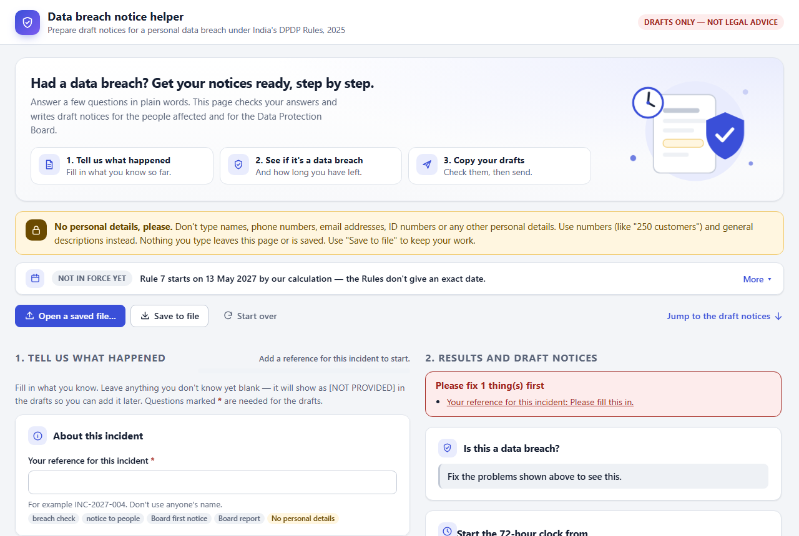

# Data breach notice helper (dpdp-breach-kit)

**Had a personal data breach in India? This free tool helps you get your notices ready, step by
step, under the Digital Personal Data Protection (DPDP) Rules, 2025.**

### [▶ Open the tool in your browser](https://pvud14.github.io/dpdp-breach-kit/)

Nothing to install, no sign-up. What you type stays on your own computer.

> **Drafts only, not legal advice.** This tool helps you organise the facts and write *first
> drafts*. It does not decide whether you must report a breach, and it has not been independently
> checked by a lawyer yet. Always have a qualified lawyer review the drafts before you send them.

## Who is it for?

Anyone in an Indian organisation who has to respond to a personal data breach: data protection
officers, compliance and legal teams, IT and security leads, and founders of small businesses. You
do not need to be technical.

## What does it do?

| Step | What you do | What the tool gives you |
|---|---|---|
| **1. Tell us what happened** | Answer questions in plain words: when you found out, what kind of data, roughly how many people, what you have done so far. | A progress bar showing what is still missing. |
| **2. See where you stand** | Choose when the 72-hour clock starts. | Whether your answers match the law's definition of a data breach, the 72-hour deadline for the Data Protection Board, and how much time has passed. |
| **3. Get your drafts** | Review the text, fill any gaps, and copy or download it. | Three drafts: a notice to the people affected, a first notice to the Board, and a detailed report to the Board. |
| **4. Save your work** | Click "Save to file". | A file you can open again later to carry on. |

Anything you have not filled in shows up in the drafts as **[NOT PROVIDED]**. The tool never makes
facts up. Where the law is unclear, the drafts say so instead of guessing.

## Common questions

**Is my information sent anywhere?**
No. The page runs entirely in your browser. It sends nothing over the internet, and it saves
nothing on your computer unless you click "Save to file". When you close the tab, your answers are
gone, so save to a file if you want to keep them.

**What should I *not* type in?**
Names, phone numbers, email addresses, ID numbers or any other personal details. Use counts and
general descriptions instead, for example "about 250 customers' email addresses".

**Is this an official government website?**
No. It is an independent open-source project hosted on GitHub Pages. Always open it from the link
on this page. If your organisation needs extra protection (for example against other sites
embedding the page), it can host its own copy: see [docs/DEVELOPERS.md](docs/DEVELOPERS.md).

**Is this legal advice?**
No. It is a drafting aid. A lawyer should review every draft before you send it.

**Does the law apply yet?**
Not yet, by our calculation. The breach notice rule (Rule 7) starts **18 months after the Rules
were published on 13 November 2025**, which works out to **13 May 2027**. The Rules do not print
an exact date, and another reading gives 14 May 2027. You can still use the tool now to prepare and
practise.

**Is there an official government form?**
Not that we have found, as of 22 October 2026. The Board drafts here are plain text organised by
what Rule 7 asks for; they are not an official form.

**Can my team practise with it?**
Yes. There are [six fictional practice scenarios](docs/tabletop/facilitator-guide.md) (for example
ransomware at a vendor, a lost laptop, a phishing attack), each with a ready-made file you can open
in the tool with "Open a saved file…".

## Current status (as of 22 October 2026)

- **Draft.** The checks a person must do before relying on this work are listed in
  [docs/VERIFICATION.md](docs/VERIFICATION.md) and are not yet complete. Do not rely on it for a
  real incident without your own legal review.
- **Rule 7 commencement.** Rule 1(4), as corrected by G.S.R. 892(E), brings Rule 7 into force
  "eighteen months after the date of publication in the Official Gazette"; the Rules were published
  on 13 November 2025 (G.S.R. 846(E)). The computed date is **13 May 2027** (alternative reading:
  14 May 2027, AMB-14). No later amendment was found; that search was not exhaustive.
- **Board format.** No official Data Protection Board breach-report format, template or portal was
  found (AMB-08).
- **Known gaps.** The tool cannot yet record encryption status, the notice language, notices to
  parents or guardians, or the outcome of a legal exemption assessment. Details and other open
  points are in [docs/DEVELOPERS.md](docs/DEVELOPERS.md#known-limitations).

Check these points again before relying on them: they can change after the date above.

All requirements, official sources and every known ambiguity in the law are in
[docs/requirements.md](docs/requirements.md).

## For developers

Building, testing, self-hosting, the code layout and the incident file format are covered in
**[docs/DEVELOPERS.md](docs/DEVELOPERS.md)**.

## Contributing, security and licence

See [CONTRIBUTING.md](CONTRIBUTING.md) and [SECURITY.md](SECURITY.md). Everyone who has contributed
is listed in [CONTRIBUTORS.md](CONTRIBUTORS.md).

Licensed under the Apache License, Version 2.0: see [LICENSE](LICENSE) and [NOTICE](NOTICE).
Copyright 2026 PVUDivakar.
