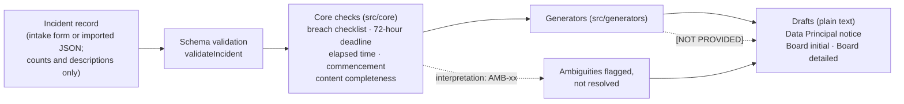

# For developers

Technical details for people who want to build, test, host or change dpdp-breach-kit. For a
plain-language overview, see the [README](../README.md).

## How it fits together



Every function that meets an ambiguity returns an `interpretation` entry naming its `AMB-xx` ID;
the drafts end with the list of ambiguities that apply and a plain-language review checklist.

## What is here

| Path | What it is |
|---|---|
| `src/core` | Incident schema and types, breach checklist (Act s.2(u), s.17(1)), 72-hour deadline, "without delay" elapsed-time tracker, commencement banner, content completeness. No DOM, network or storage access. |
| `src/generators` | Plain-text drafts: the Data Principal notice (r. 7(1)) and the Board initial (r. 7(2)(a)) and detailed (r. 7(2)(b)) intimations. Missing facts appear as `[NOT PROVIDED]`; nothing is invented. |
| `src/ui`, `index.html` | Static intake page: form, live checks, drafts, JSON import/export. |
| `docs/requirements.md` | Requirements and every known ambiguity (`AMB-xx`), taken from the official texts. |
| `docs/source/` | [SOURCES.md](source/SOURCES.md): URL, file name, SHA-256, page count, identifier and download date for each official PDF. The PDFs themselves are not committed; download them here and run `npm run verify:sources`. |
| `docs/tabletop/` | Facilitator guide and six fictional tabletop scenarios, each with an example incident record. |
| `docs/VERIFICATION.md` | Checks a person must do before relying on or publishing this work. |
| `docs/RELEASE-READINESS.md` | Every claim in the README, this file and the launch drafts, with its evidence. |
| `docs/images/` | Screenshot of the intake page used in the README. |
| `docs/launch/` | Draft launch post and demo-recording steps. |
| `scripts/` | Network check, source-hash check, and the Vitest launcher. |

## Using the intake page

```sh
npm ci
npm run build      # library into dist/, intake page into dist/app/
npm run preview    # serves dist/app/ on localhost
```

**Serving requirement.** The page must be served over HTTP or HTTPS. Opening `dist/app/index.html`
directly from disk (`file://`) does not work, because browsers block ES modules there. Any static
file server can host `dist/app/`. Copy-to-clipboard additionally needs a secure context (HTTPS or
`localhost`); otherwise the page asks you to copy manually. The Content-Security-Policy is set by a
`<meta>` tag; if you host the page, also send it as an HTTP header, which is the only way to add
`frame-ancestors`.

**Hosted copy.** `.github/workflows/pages.yml` builds `dist/app/` on every push to `main` and
publishes it to GitHub Pages at <https://pvud14.github.io/dpdp-breach-kit/>. It needs a one-time
setting: Settings → Pages → Source: "GitHub Actions". GitHub Pages cannot send custom HTTP
headers, so the hosted copy relies on the `<meta>` CSP only and has no `frame-ancestors`
protection; host it yourself if you need that.

**Privacy.** The page makes no network requests (CSP `connect-src 'none'`), uses no browser
storage, cookies or service workers, and keeps the record in memory only: **export the incident
JSON to keep it.** Imported files are checked against the schema and rejected if they contain
unknown fields. Do not enter names, contact details or other personal data: the record holds
counts and descriptions only.

**Accessibility.** Two things have been checked automatically: arrow-key navigation between the
draft tabs, and that every input, select and text area has a label. The form is built from native
controls and buttons so it can be used with a keyboard, but full keyboard use has not been tested
end to end. No other accessibility conformance is claimed.

## Tabletop exercises

[tabletop/](tabletop/facilitator-guide.md) has a facilitator guide and six fictional
scenarios (ransomware at a data processor, misconfigured storage bucket, insider exfiltration,
lost unencrypted laptop, phishing leading to account takeover, third-party API leak). Each runs in
60–90 minutes, has timed injects from T+0 to T+72h, and ships an example incident record you can
import into the intake page. Ambiguities are posed as questions; no scenario states a legal
conclusion.

## Timestamps

- Every timestamp in an incident record is ISO-8601 **with an explicit offset**, e.g.
  `2026-10-20T09:00:00+05:30` or `2026-10-20T03:30:00Z`. Times without an offset are rejected.
- The intake page **enters and displays times in IST (Asia/Kolkata, UTC+05:30)**. IST has no
  daylight saving, so 72 hours is always exactly 72 elapsed hours.
- A record imported with another offset is shown in IST and, when exported again, written with
  `+05:30`. The instant is unchanged; only its representation changes.
- The form records times to the second; fractions of a second in an imported record are dropped
  if it is edited and exported from the page.
- The 72-hour deadline needs an explicit choice of whose awareness starts the clock (Data
  Fiduciary, Data Processor, or earliest). There is no default (AMB-01, AMB-13). Whether a report
  at exactly 72:00:00 is in time is reported as "at deadline", not decided (AMB-18).

## Scripts

Requires Node.js 22.12 or later.

| Script | What it does |
|---|---|
| `npm run check` | `tsc -p tsconfig.lint.json`: the TypeScript compiler with extra strictness checks (unused locals and parameters, implicit returns, switch fallthrough, unreachable code, index-signature property access). It is **not** ESLint: no style rules, because the project takes no dependencies beyond TypeScript, Vite and Vitest. `npm run lint` is an alias. |
| `npm run typecheck` | `tsc -p tsconfig.json` (strict, no emit). |
| `npm test` | Runs the Vitest suite once, through `scripts/run-vitest.mjs`, which normalises a lower-case Windows drive letter (see CONTRIBUTING.md). |
| `npm run build` | Builds the library (`src/index.ts`) into `dist/`, then the intake page into `dist/app/`. |
| `npm run dev` | Vite dev server for the page. Hot reload does not work: the CSP blocks its WebSocket. |
| `npm run preview` | Serves the built `dist/app/` locally. |
| `npm run check:network` | Builds `dist/app/`, serves it on `127.0.0.1`, and drives a local headless Chrome/Chromium through the page (fill, tabs, copy, download, export, import, 360px width). Fails on any request outside the page's own origin, any CSP violation or page exception, or any storage or cookie use. Needs Chrome or Chromium installed; no npm dependency. Set `CHROME_PATH` to choose the binary and `CHROME_NO_SANDBOX=1` where the Chrome sandbox is unavailable. Runs in CI as a non-blocking job until its first green run on Linux. |
| `npm run verify:sources` | Recomputes the SHA-256 of every PDF in `docs/source/` and compares it with the values recorded in `docs/requirements.md` §1. Exit 0: all match. Exit 1: a mismatch, or a PDF with no recorded hash. Exit 2: "sources not downloaded" — prints each missing file's URL and expected SHA-256. Exit 3: the table could not be read. CI treats exit 2 as a skip and downloads nothing. |

## Known limitations

These are open. None of them is fixed in this version.

**Incident schema gaps.** The incident record (`src/core/incident.schema.json`) has no field for:

- **Encryption status** of the affected data or device (relevant, for example, to a lost laptop).
  The checklist cannot take it into account, and Rule 7 states no threshold that would (AMB-05).
- **Notice language.** The language(s) of the Data Principal notice are not recorded; Rule 7 states
  no language requirement. The Data Principal draft's review checklist asks a person to choose the
  language deliberately.
- **Guardian recipients.** There is no way to record that affected Data Principals are children or
  persons with disability, or that intimation goes to parents or lawful guardians.
- **Exemption-assessment outcome.** An Act s.17(1) exemption can be *claimed*, but the result of a
  legal assessment cannot be recorded, so the checklist keeps reporting
  "requires legal determination" (AMB-15).

**Ambiguities recorded but not handled in the drafts.** Two points found while writing the
tabletop scenarios are now recorded in `docs/requirements.md` §5 but are not yet handled by the
core checks or the generators; the drafts do not list them:

- **AMB-19 — "Data Principal" for children and persons with disability (Act s.2(j)).** The
  definition includes parents or lawful guardians; Rule 7(1) does not say who receives the
  intimation or whose registered channel is meant.
- **AMB-20 — more than one Data Fiduciary (Act s.2(i)).** A fiduciary may act "in conjunction with
  other persons"; Rule 7 does not say which fiduciary intimates, whether each must, or how
  duplicate notices are handled.

Planned work is in [BACKLOG.md](BACKLOG.md).

## Contributing, security and licence

See [CONTRIBUTING.md](../CONTRIBUTING.md) (one branch per issue, one review, maintainer approval for
scope and rule-interpretation changes, no real personal data) and [SECURITY.md](../SECURITY.md) for
private vulnerability reporting. Everyone who has contributed is listed in
[CONTRIBUTORS.md](../CONTRIBUTORS.md).

Licensed under the Apache License, Version 2.0: see [LICENSE](../LICENSE) and [NOTICE](../NOTICE).
Copyright 2026 PVUDivakar.
